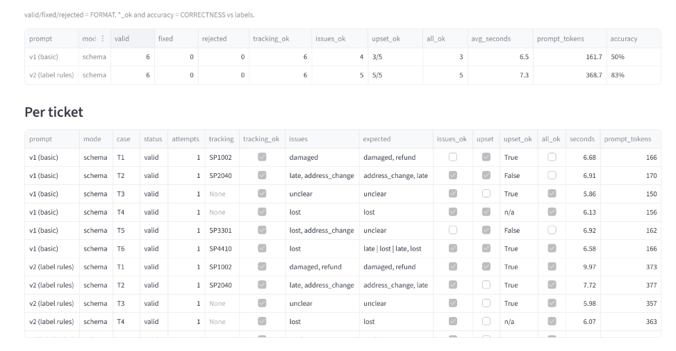

# AI Structured Output: SwiftParcel Ticket Extractor

Turns messy customer messages into **validated, typed tickets** using a local LLM (Ollama + llama3.2:3b) and **Pydantic**. It also measures whether the output is actually **correct**, not just whether it's valid.



## What it does
```
customer message → LLM → JSON → Pydantic ──✅──→ Ticket
                                  │
                                  └──❌──→ error text → back to LLM (retry, max 2)
```

**Input:** `Hi, I'm Priya. Parcel SP1002 arrived smashed, I want my money back!`

**Output:**
```json
{"customer_name": "Priya", "tracking_number": "SP1002",
 "issues": ["damaged", "refund"], "customer_upset": true,
 "summary": "Parcel SP1002 arrived damaged; customer wants a refund."}
```

## Validation layers
| Check | Catches |
|---|---|
| Shape (types, enum values, `extra="forbid"`) | wrong types, unknown labels, extra fields |
| Grounding | tracking numbers the LLM **invented** |
| Completeness | tracking numbers the LLM **missed** (null or missing key) |
| Cross-field | `unclear` mixed with real issues |

Validation errors are fed back to the model, so it can fix its own mistakes.

## Results (llama3.2:3b, 6 labelled tickets, schema mode)
| Prompt | Valid | Tracking | Issues | Upset | **Accuracy** | Prompt tokens | Avg time |
|---|---|---|---|---|---|---|---|
| v1 (basic) | 6/6 | 6/6 | 4/6 | 3/5 | **50%** | 162 | 6.5 s |
| v2 (label rules) | 6/6 | 6/6 | 5/6 | 5/5 | **83%** | 369 | 7.3 s |

## What I learned
- **Valid ≠ correct.** Every mode passed validation 100%, but accuracy against labels was only 50–67%. Format and correctness are scored separately.
- **Fixes cause regressions.** Adding label rules improved issue accuracy but dropped tracking extraction from 6/6 to 3/6, until I added a completeness check.
- **Pydantic skips validators on defaults.** `Optional[str] = None` let the LLM leave a key out and bypass every check. `Field(...)` (required but nullable) fixed it and forced constrained decoding to output every key.
- **A schema change is a behaviour change.** Changing the schema moved v1's accuracy without any prompt change, so I re-run the eval after every edit.
- **Constrained output removes retries.** Prompt-only mode needed a 23 s retry on an injection message; schema mode got it right first time.

## Output modes compared
| Mode | Ollama setting | Guarantees |
|---|---|---|
| `prompt` | rules in prompt only | nothing |
| `json` | `format="json"` | valid JSON |
| `schema` | `format=Ticket.model_json_schema()` | right fields + types (not truth) |

## Project structure
| File | Purpose |
|---|---|
| `ticket_schema.py` | Pydantic `Ticket` model and validators |
| `extractor.py` | Ollama call, JSON cleanup, validate-and-retry loop, prompt versions |
| `day11_structured_output.py` | Streamlit app: extractor, mode/prompt comparison with labelled eval, validator playground |
| `test_day11.py` | 22 pytest tests using a fake LLM (no Ollama needed) |

## Run it
```bash
ollama pull llama3.2:3b
pip install -r requirements.txt
python -m pytest -q
python -m streamlit run day11_structured_output.py
```

## Tech
Python · Pydantic v2 · Ollama · llama3.2:3b · Streamlit · pandas · pytest
